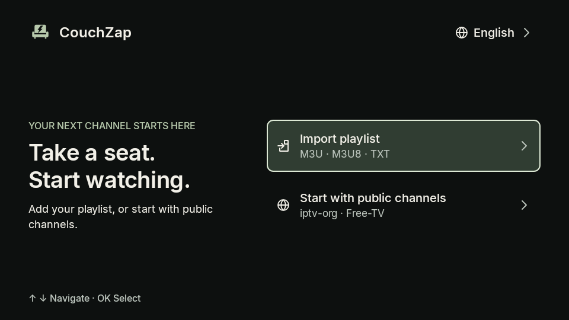
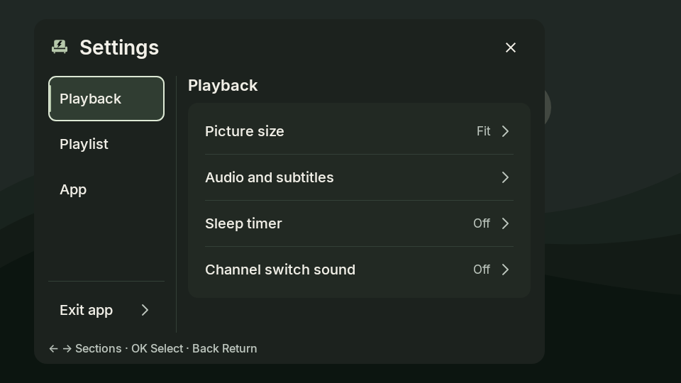

<p align="center">
  
</p>

<h1 align="center">CouchZap</h1>
<p align="center"><strong>Take a seat. Start watching.</strong><br>A remote-friendly IPTV player for Android TV and phones.</p>
<p align="center">
  <a href="https://github.com/saeedt20/CouchZap/releases/latest"></a>
  
  <a href="LICENSE"></a>
</p>
<p align="center">
  <a href="https://github.com/saeedt20/CouchZap/releases/latest">Download APK</a> ·
  <a href="#screenshots">Screenshots</a> ·
  <a href="docs/USAGE.md">User guide</a> ·
  <a href="https://github.com/saeedt20/CouchZap/issues">Report an issue</a>
</p>

CouchZap brings your playlists to a sage-green interface with clear remote focus, channel search, favourites and playback controls. Built with native Kotlin/Android views and Media3. **No account required.**

## Download and start

1. Download **[CouchZap-3.1.1.apk](https://github.com/saeedt20/CouchZap/releases/download/v3.1.1/CouchZap-3.1.1.apk)** and its [SHA-256 checksum](https://github.com/saeedt20/CouchZap/releases/download/v3.1.1/CouchZap-3.1.1.apk.sha256).
2. Install it on your Android TV, TV box or phone. Allow installation from the app opening the APK if Android asks.
3. Choose **Import playlist** for an M3U/M3U8/TXT file, or opt into **Start with public channels**. Links and source changes are available under **Settings → Playlist sources**.
4. Select a channel.

**Upgrading:** install 3.1.1 over the official 3.1.0 app to retain data; do not uninstall first. Stable 3.1.0 can discover it through **Check for updates**. From a 3.0 beta, download the APK manually once. Android updates require the established signing certificate.

CouchZap does not supply a subscription, bundle streams or guarantee public-channel availability. Use sources you are authorized to access.

## Screenshots

<table>
<tr><th>TV welcome</th><th>TV settings</th></tr>
<tr><td></td><td></td></tr>
</table>

*Native redesign captures with fixture content, taken before the final 3.1 fixes. They do not demonstrate physical-device playback.*

## Features

- **Browse comfortably:** channel search, groups, favourites, logos, numeric selection and last-watched recall.
- **Choose your sources:** local files, HTTP(S) playlists and optional [iptv-org](https://github.com/iptv-org/iptv) or [Free-TV](https://github.com/Free-TV/IPTV) directories. Failed imports preserve the previous playlist.
- **Watch your way:** HLS, DASH, RTSP and compatible progressive streams, source-provided audio/subtitles, picture modes and retry controls.
- **Programme guide:** local or linked XMLTV, including gzip, with now/next information when guide IDs match.
- **TV and phone layouts:** remote navigation, touch gestures, phone rotation controls, sleep timer and optional channel-switch sound.
- **Six languages:** English, Español, हिन्दी, ไทย, فارسی and العربية. English is the default; Persian/Arabic use RTL text and right-docked panels.
- **Requested updates and diagnostics:** checksum/certificate-checked updates and an app-only diagnostic report you preview before sharing.

Playlists and guides are cached locally and refreshed manually. See the [user guide](docs/USAGE.md) for source formats, language behavior, persistence and diagnostics.

## Controls

| TV remote | Action |
|---|---|
| OK / Up during playback | Open channels |
| Up / Down, then OK | Browse and play |
| Hold OK on a channel | Toggle favourite |
| Right / CH+; Left / CH− during playback | Next; previous channel |
| Down / Info | Open controls; Info again shows stream details |
| Menu / Back | Settings; close the active panel |

On phones: tap for controls, double-tap to play/pause, swipe left/right to change channels and swipe up for the list. See the [complete remote and touch guide](docs/USAGE.md#controls), including RTL behavior and key mappings.

## Build and verification

Use **JDK 21**, Android SDK **35** and Build Tools **36.0.0** with the pinned Gradle wrapper:

```sh
git clone https://github.com/saeedt20/CouchZap.git
cd CouchZap
./gradlew :app:assembleDebug :app:testDebugUnitTest :app:lintDebug
```

Set the SDK through Android Studio, `ANDROID_HOME` or an untracked `local.properties`. Windows uses `gradlew.bat`. Debug output is `app/build/outputs/apk/debug/app-debug.apk`. [Release signing and publishing](docs/releases/publishing.md#developer-signing) require a private keystore; no signing secret belongs in Git.

The [3.1.1 acceptance record](docs/releases/v3.1.1-verification.md) documents 331 unit/Robolectric cases, builds, lint and signed-payload verification. Physical-device checks for 3.1.1 were not run; remotes, decoders/HDR, touch/IME and upgrade installation remain hardware-dependent. No provider-account login, DRM configuration, recording or catch-up service is included.

## Privacy, history and license

Playlists, guides, favourites and preferences stay in private app storage. There is no analytics or advertising service. Playback and imports connect to your selected providers; HTTP sources remain unencrypted. Diagnostic sharing and updates are requested by you.

- [Current release notes](docs/releases/v3.1.1.md) · [3.1.0 redesign](docs/releases/v3.1.0.md)
- [User guide](docs/USAGE.md) · [Publishing process](docs/releases/publishing.md)
- [Original CRT sample and CC0 notice](docs/assets/crt_sound.md)

Original application code is **[MIT-licensed](LICENSE)**, copyright © 2026 Saeed Taheri (سعید طاهری). Upstream Media3, AndroidSVG, Robolectric and other dependencies retain their licenses. Thanks to iptv-org and Free-TV for their public directories.
