<p align="center">
  
</p>

<h1 align="center">CouchZap</h1>
<p align="center"><strong>Take a seat. Start watching.</strong><br>A calm, remote-friendly IPTV player for Android TV and phones.</p>

<p align="center">
  <a href="https://github.com/saeedt20/CouchZap/releases/latest">Download APK</a> ·
  <a href="#screenshots">Screenshots</a> ·
  <a href="#controls">Remote guide</a> ·
  <a href="https://github.com/saeedt20/CouchZap/issues">Report an issue</a>
</p>

CouchZap brings your playlist to the living room with a sage-green interface, clear focus states and uncluttered playback controls. Add a local file or playlist link, or optionally start with public channels from [iptv-org](https://github.com/iptv-org/iptv) or [Free-TV](https://github.com/Free-TV/IPTV).

Native Kotlin and Android views · Android 7.0+ · Media3 playback · No account required

## Download and start

1. Download **CouchZap-2.2.1.apk** from [Releases](https://github.com/saeedt20/CouchZap/releases/latest), together with its [SHA-256 checksum](distribution/CouchZap-2.2.1.apk.sha256). Source archives are also available on each release page.
2. Install it on your Android TV, TV box or phone. Allow installation from the app used to open the APK if Android asks.
3. The app opens the welcome screen directly. Optionally choose a language, then **Import playlist** for a local M3U, M3U8 or TXT file, or **Start with public channels**.
4. Select a channel and enjoy.

Use **Settings → Playlist sources** to import an HTTP(S) link, choose another source or refresh the current playlist. Choose a provider, then a country/language/category for iptv-org or a country/themed list for Free-TV. Remote Up/Down moves one option at a time, including in long or filtered public lists. Choose source order or natural name order; source channel numbers remain unchanged. Public imports are opt-in.

Public channel availability depends on the source and your location. CouchZap downloads playlists when requested; it does not bundle streams or provide a subscription service.

## Languages

Choose a language from the welcome screen or **Settings → Language**. Selection is optional on first launch; the default is English. Your choice is saved and applied immediately, including after restarting the app.

| Menu order | Language | Text direction | Channels and settings |
| --- | --- | --- | --- |
| 1 | English | Left to right | Left side |
| 2 | Español | Left to right | Left side |
| 3 | हिन्दी | Left to right | Left side |
| 4 | ไทย | Left to right | Left side |
| 5 | فارسی | Right to left | Right side |
| 6 | العربية | Right to left | Right side |

Each language includes interface messages, settings, updates, diagnostics and known channel categories. Custom channel/group names and playlist identities are preserved.

## Screenshots

These images render the app's actual Android views using Robolectric 4.16.1 native graphics. The new six-language welcome and English/Arabic panel images use API 28; the older Android 16 examples below use API 36. Channel data and the illustrative backdrop are fixtures. Motion is disabled for stable screenshots.

| Screen | English | العربية |
| --- | --- | --- |
| Welcome | 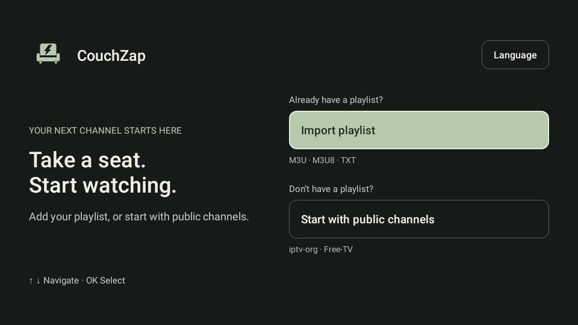 | 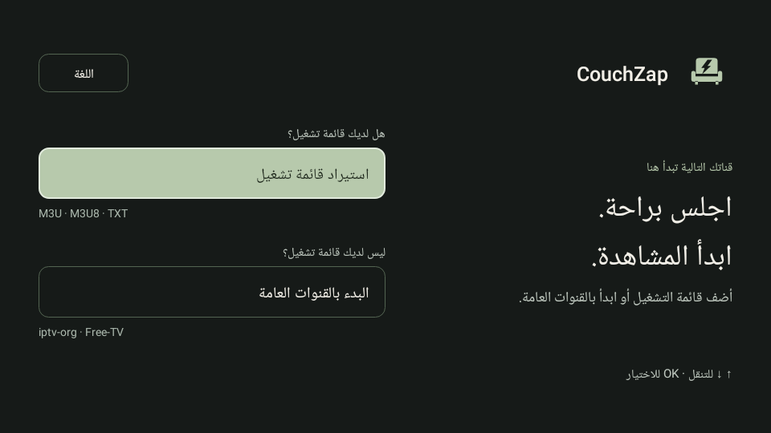 |
| Channels |  | 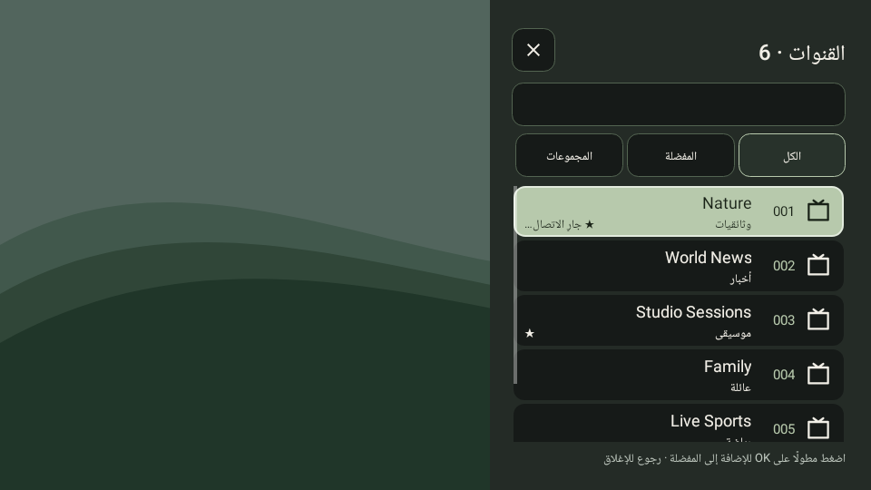 |
| Info | 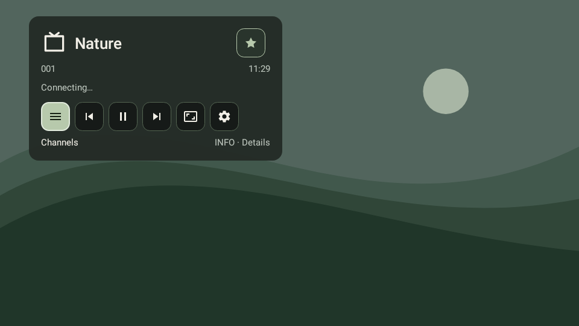 | 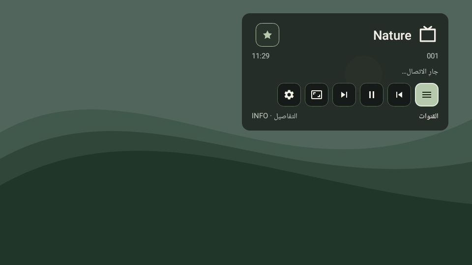 |
| Settings | 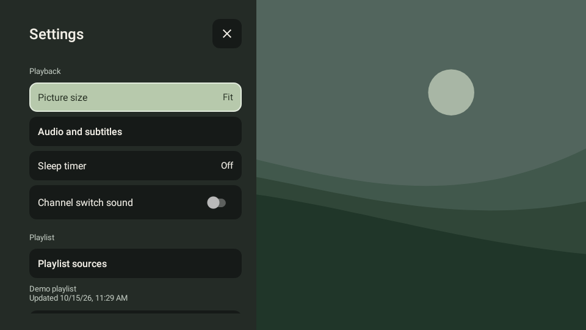 | 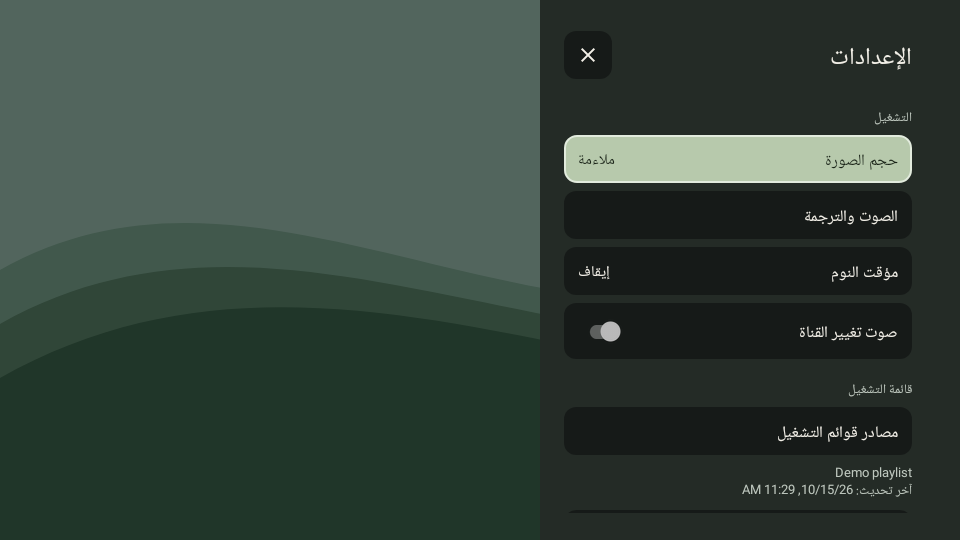 |

<details>
<summary>Phone welcome in all six languages, in menu order</summary>

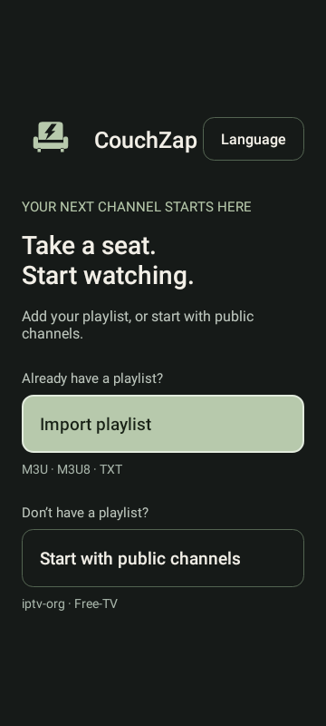
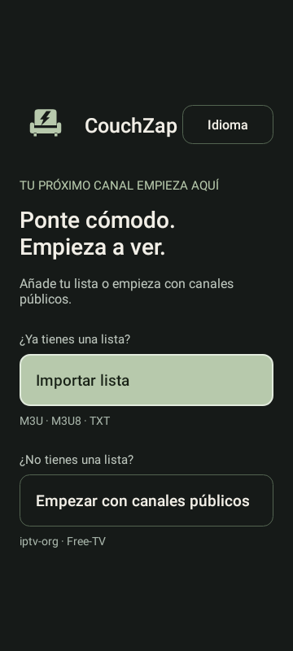
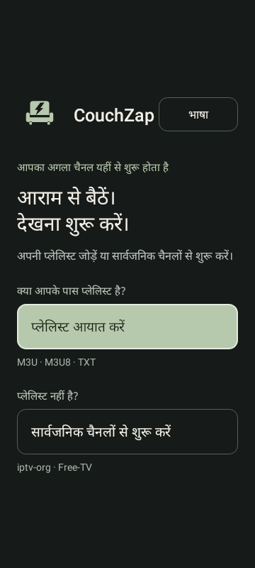
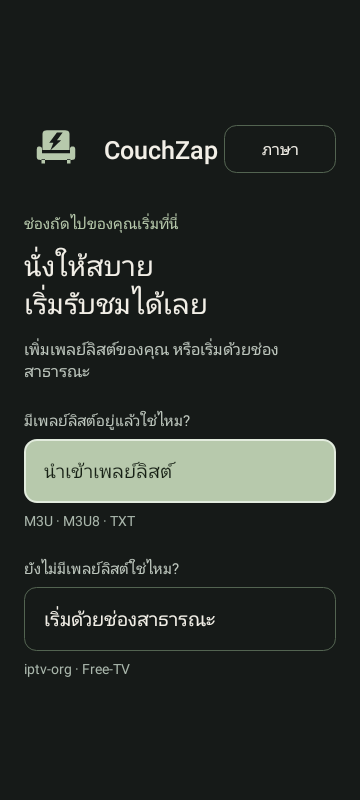
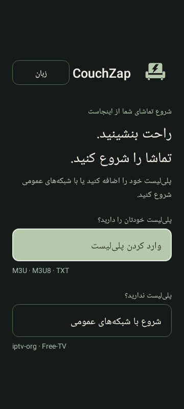
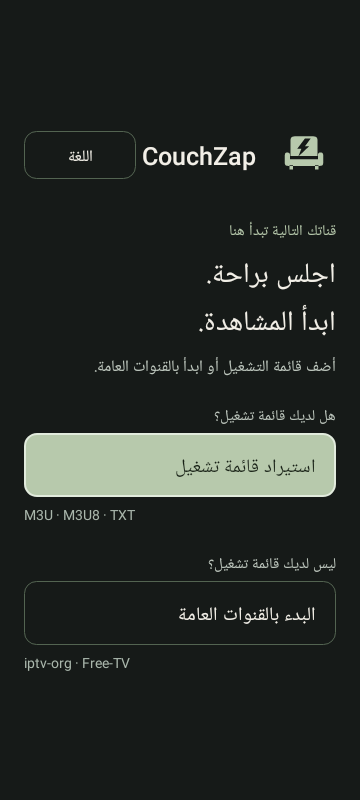

</details>

<details>
<summary>Android 16 settings and Persian search from 2.1.x</summary>

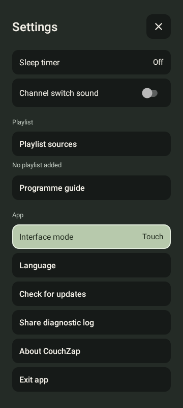
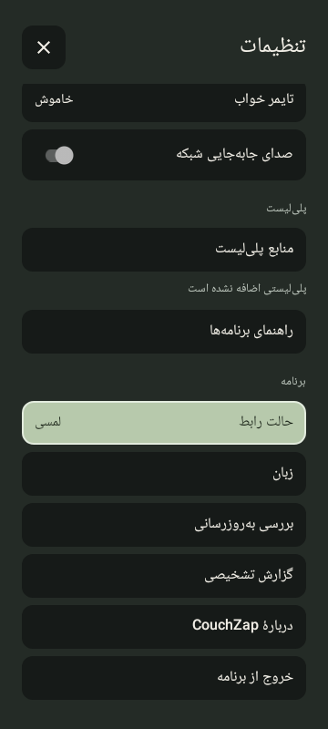

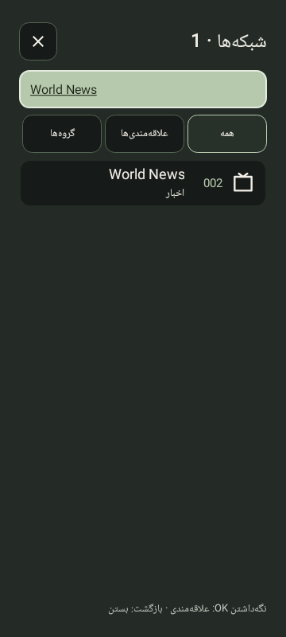
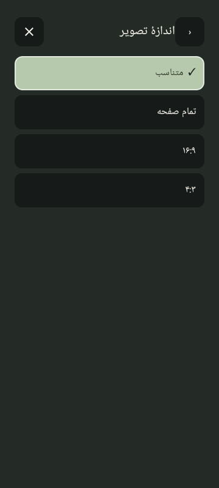

</details>

<details>
<summary>Favourite button: absent and added</summary>

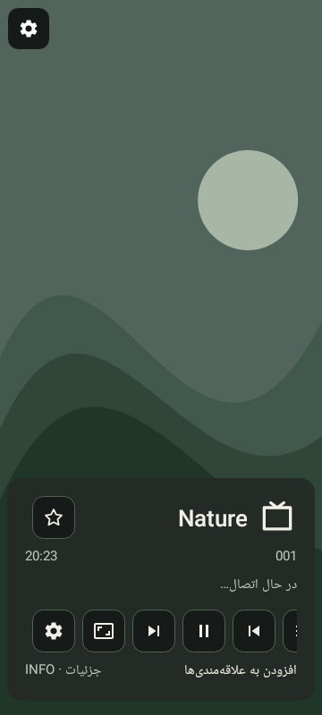
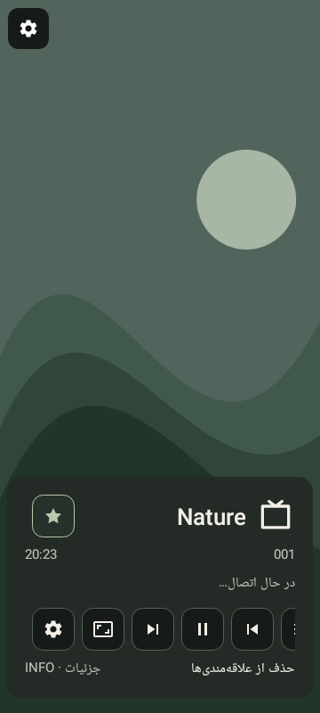

</details>

## Features

- **A calmer interface:** couch-and-lightning identity, warm sage accents, generous buttons and visible remote focus.
- **A better channel browser:** search that retains typing and the cursor while results update, groups, favourites, channel logos and a distinct playback-status label. The panel docks right in Persian and Arabic, and left in English, Spanish, Hindi and Thai. Focus and the currently selected channel remain separate, including during asynchronous connection errors. Up from the first visible channel wraps to the last; Down wraps back to the first.
- **Flexible playlist sources:** local files, HTTP(S) links and selectable public iptv-org and Free-TV directories. Cached channels remain available between launches; failed imports preserve the previous playlist.
- **Useful Info controls:** channel name, number, clock, play/pause, an outlined/filled favourite star and a second level for available codec, resolution and bitrate information.
- **Programme guide:** XMLTV from a file or link, including gzip files. Shows now/next and programme progress when guide IDs match the playlist.
- **Playback options:** HLS, DASH, RTSP and compatible progressive streams, available audio/subtitle tracks, Fit/Fill/16:9/4:3 picture modes, reconnect attempts and a retry/next-channel error panel.
- **Updates from Settings:** check the latest stable GitHub release, download it with progress, verify its checksum and CouchZap signing certificate, then open Android’s installer. Installation always requires your confirmation.
- **Diagnostic reports:** preview, share or save an app-only log from Settings. It contains device/version details and error classes/stacks; playlist URLs, channel names, tokens and account data are excluded. Boxes without a sharing/file app can copy the report to the clipboard.
- **Six interface languages:** choose English, Español, हिन्दी, ไทย, فارسی or العربية, in that order, from the welcome screen or Settings. First launch opens the welcome screen directly, with English as the default. Persian and Arabic use RTL text and right-docked channels/settings; English, Spanish, Hindi and Thai use LTR text and left-docked panels. Known IPTV groups are translated without changing playlist identities. Settings subpages retain parent focus and scroll when you press Back.
- **Light welcome motion:** a one-time intro that completes on the first key or touch while still handling that input. System animation settings are respected; Android 7 panels open immediately.
- **Optional CRT click:** enable **Settings → Playback → Channel switch sound** for an original, quiet 160ms sample. It is off by default, previews when enabled and plays only on committed channel changes; browsing, retries and reconnects stay silent. Media volume and mute are respected.
- **Everyday conveniences:** last watched channel, numeric selection for large playlists, a 15/30/60/90-minute sleep timer and saved interface preferences.
- **TV and phone support:** automatic device detection, manual TV/Phone modes, TV overscan padding, responsive phone layout and touch gestures.

Favourites and the current channel survive playlist refreshes when `tvg-id`, or the fallback name and group identity, remain stable. Refresh is manual; cached playlists and guides do not update automatically.

## Controls

### TV remote

| Button | Action |
| --- | --- |
| OK / Up during playback | Open channels |
| Up / Down in channels | Move focus; wrap at the first/last visible row |
| OK on a channel | Play it |
| Hold OK on a channel | Add/remove favourite |
| Left from a channel row | Reach the filter buttons, then search |
| Right / CH+ / Page Up during playback | Next channel |
| Left / CH− / Page Down during playback | Previous channel |
| Down / Info | Show controls; press Info again for stream details |
| Number keys / Delete / OK | Enter / correct / confirm a channel number |
| Play / Pause / Play-Pause | Play / pause / toggle |
| Last Channel | Return to the previous watched channel |
| Menu | Open settings |
| Back | Close the active panel; press twice with panels closed to exit |

Arrow keys move between buttons when a control panel has focus. Key mappings can vary between remotes. The expanded Info panel also includes a previous-watched-channel button.

### Phone

Tap the video to show/hide controls, double-tap to play/pause, swipe left/right to switch channels and swipe up to open the channel list. Use the gear button for settings.

## Playlists and programme guide

M3U metadata includes `tvg-id`, `tvg-logo`, `group-title`, User-Agent/Referer fields and HLS/DASH manifest hints. Duplicate stream URLs are removed; channel numbers follow playlist order and stay unchanged when the displayed list is sorted by name. TXT accepts `Name,URL` entries or bare stream URLs.

```m3u
#EXTM3U x-tvg-url="https://example.org/guide.xml.gz"
#EXTINF:-1 tvg-id="example.news" tvg-logo="https://example.org/logo.png" group-title="News",Example News
https://example.org/live.m3u8
```

The URLs above are placeholders. Import your guide through **Settings → Programme guide** and use matching `tvg-id` values. A guide URL in the playlist header can be used through **Refresh guide**; guides are not downloaded automatically. Guide import keeps programmes relevant to the next 48 hours and rejects oversized files. Audio tracks, subtitles and programme information appear only when the source supplies them.

Android 7–9 also have a basic file-browser fallback if the system document picker is missing. Android 10+ require an enabled system Files/document-picker app.

## Build from source

| Tool | Version |
| --- | --- |
| JDK | 21 |
| Android SDK / target SDK | 35 |
| Android Build Tools | 36.0.0 |
| Android Gradle Plugin | 9.1.1 |
| Gradle wrapper | 9.3.1 |
| Minimum Android | 7.0 / API 24 |

```sh
git clone https://github.com/saeedt20/CouchZap.git
cd CouchZap
./gradlew :app:assembleDebug :app:testDebugUnitTest :app:lintDebug
```

Configure the SDK in Android Studio, `ANDROID_HOME` or an untracked `local.properties`. On Windows use `gradlew.bat`. Debug output: `app/build/outputs/apk/debug/app-debug.apk`.

For a signed, optimized release, set these environment variables in your shell or secure build environment:

| Variable | Purpose |
| --- | --- |
| `COUCHZAP_KEYSTORE` | Absolute path to your private release keystore |
| `COUCHZAP_STORE_PASSWORD` | Keystore password |
| `COUCHZAP_KEY_ALIAS` | Key alias; defaults to `couchzap` |
| `COUCHZAP_KEY_PASSWORD` | Key password; defaults to the store password |

```sh
./gradlew :app:assembleRelease :app:lintRelease
adb install -r app/build/outputs/apk/release/app-release.apk
```

Without a configured keystore, the release output is unsigned. Published releases use a dedicated release key. Updates must use the same key; Android cannot install it over a build signed with a different key. Uninstalling removes local playlists and preferences. Signing keys and passwords are excluded from this repository. Maintainers can read the [reviewed-release publishing notes](docs/releases/publishing.md).

## Validation and limitations

Version 2.2.1 passed **125 unit/Robolectric cases**, with zero failures, errors or skips, in [GitHub Actions](https://github.com/saeedt20/CouchZap/actions/runs/38751612163). Debug/release lint completed with no errors, and Debug and optimized Release APK assembly passed. Existing lint warnings remain.

Coverage includes API 24, 28 and 36, optional first-launch language selection, the six-language menu order, saved language after restart, live RTL/LTR switching, channel/settings panel docking, native TV/phone layouts, multiword/composing-text search, favourites, settings focus and playlist persistence. Public catalog regressions on API 24 and 36 traverse a 240-country list, select middle rows, recover missing focus and check filtered/empty results and held remote keys in English, Persian and Arabic. See the [2.2.1 release notes](docs/releases/v2.2.1.md) and earlier [localization/search checks](docs/work/phase08-localization-search.md).

The Android 16 focus-overlay fix and Android 7 startup/TLS fixes are retained. The [earlier network integration results](https://github.com/saeedt20/CouchZap/actions/runs/38611939876) document live Android 7 network checks. Release publication separately verifies the signed APK against the independent build and exercises the same signed bytes on Android TV 7; see the [publishing process](docs/releases/publishing.md).

Automated checks do not validate physical TV remotes, hardware decoders or live stream availability. Playback depends on the device's codec support and source availability. There is no provider-account login, DRM configuration, recording, catch-up service or SmoothStreaming module. Opaque HLS/DASH links use manifest hints or a server's HEAD content type; servers that supply neither may require a conventional manifest URL.

## Updates and diagnostic logs

Open **Settings → Check for updates**. Downloads come only from this repository’s stable GitHub Releases. CouchZap checks SHA-256, the application ID, version and the release signing certificate before offering installation. On Android 8+, allow CouchZap to install updates when Android asks; on Android 7, the device’s unknown-sources setting may be needed. Updates run only when requested.

Open **Settings → Share diagnostic log** to preview and share a text report, or save it to a file. Import failures also offer a shortcut to that report. Nothing is sent automatically. Logs stay in private app storage and retain a bounded recent history; they contain Android/device/version information and sanitized exception traces, rather than whole-system logcat or your playlist contents. Attach the report to a GitHub issue or send it to the maintainer.

Android 7 lacks the ISRG Root X1 certificate required by the public directory. CouchZap includes the official public root for the iptv-org and GitHub domains while keeping certificate-chain and hostname verification enabled. Other destinations continue to use system trust.

## Data and attribution

Playlists, guides, favourites and preferences stay in private app storage. CouchZap has no analytics, advertising or account service. It connects to playlist, guide, artwork and stream servers that you select; public directories connect to the chosen iptv-org or Free-TV source. HTTP sources are supported, so transport security depends on the source.

The [original CRT sample](docs/assets/crt_sound.md) is synthesized locally without third-party recordings and dedicated under CC0 1.0.

Thanks to [Free-TV](https://github.com/Free-TV/IPTV), [iptv-org](https://github.com/iptv-org/iptv) for its public playlist directory and metadata API, [AndroidX Media3](https://github.com/androidx/media) for playback, [AndroidSVG](https://github.com/BigBadaboom/androidsvg) for SVG artwork, and [Robolectric](https://github.com/robolectric/robolectric) for Android regression testing.

For bugs, include device/Android version, reproduction steps and sanitized logs in [GitHub Issues](https://github.com/saeedt20/CouchZap/issues).
