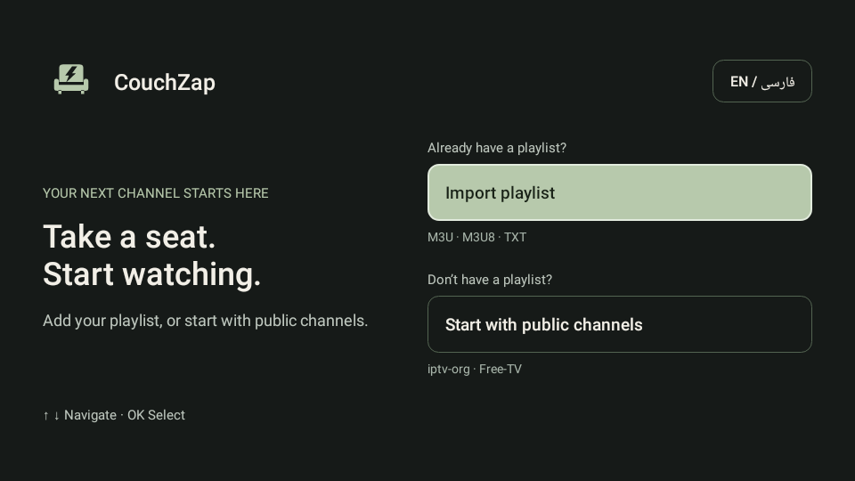
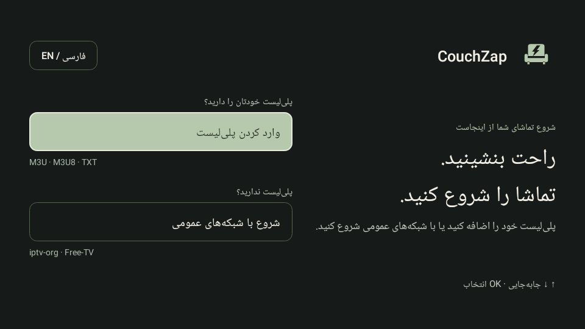
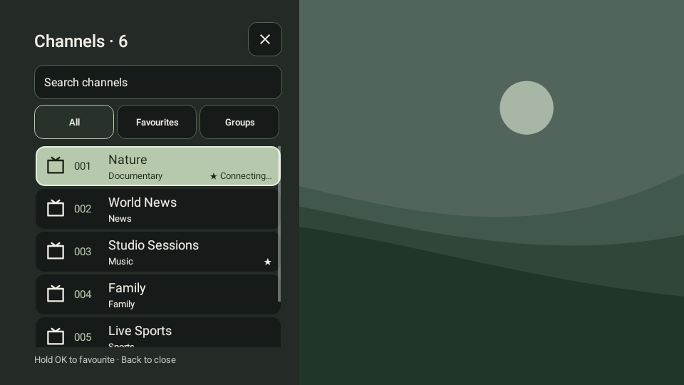
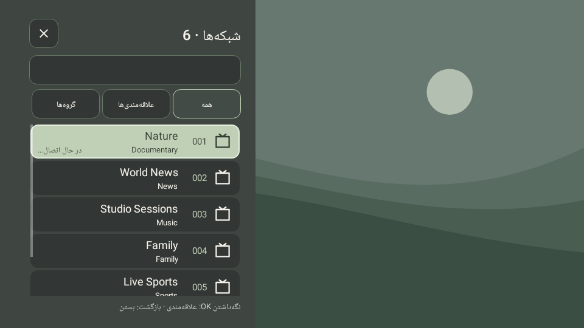
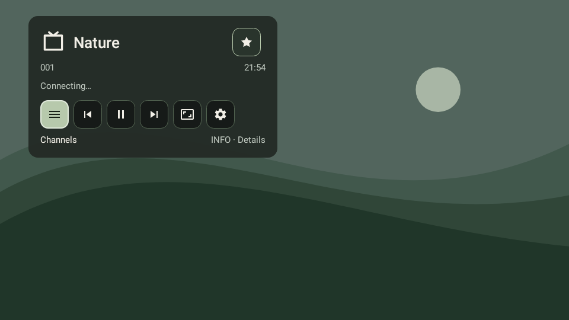
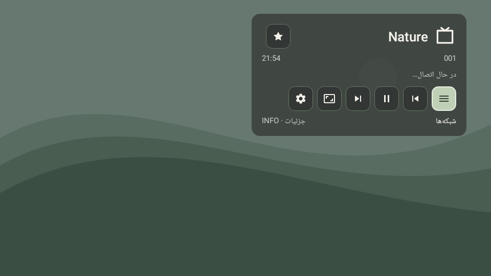
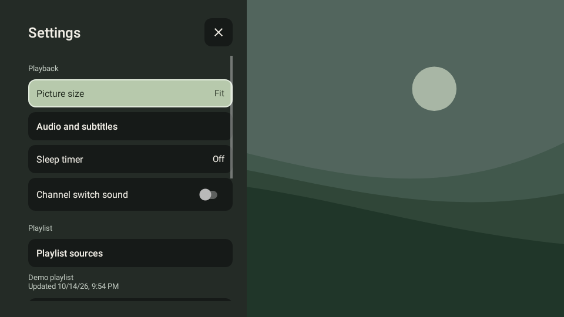
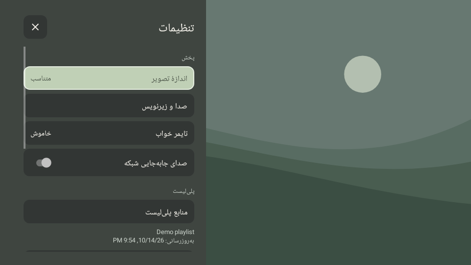

# README update draft — four-stage candidate

Prepared locally for review. This is documentation for the implementation candidate, not a published release announcement. Keep the published download/version information unchanged until a separate release is authorized.

## Suggested introduction and startup text

CouchZap brings your playlist to the living room with a sage interface, clear remote focus and uncluttered playback controls. Choose Persian or English, then import your own playlist or optionally start with public channels from iptv-org or Free-TV. No public playlist is downloaded automatically.

**Settings → Playback → Channel switch sound** enables a quiet, original CRT-style click. It is off by default in this candidate. Enabling previews it once; browsing channels, reconnects and retries stay silent. Device media mute and volume are respected.

The first welcome animation runs once, accepts input immediately and completes when you press a key or touch the screen. System animation settings are respected. Android 7 panels retain the immediate opening path.

## Suggested screenshots section

These images render the application's actual Android views with Robolectric 4.16.1 native graphics on API 28, at 960 × 540. Channel names and the illustrative backdrop are fixtures. They are not physical-device screenshots, live broadcast captures or evidence of hardware playback performance. Motion is disabled for stable captures.

| Screen | English | Persian |
| --- | --- | --- |
| Welcome |  |  |
| Channels |  |  |
| Info |  |  |
| Settings |  |  |

## Suggested feature additions

- Persian/English switching inside the shared settings panel; Persian uses RTL content while the channels/settings panels remain docked on the left.
- Country, language and category choices for iptv-org, plus country and themed lists from Free-TV. Known web-player-only entries are excluded from public imports; direct stream availability depends on the source and device.
- Source order or natural name sorting, with channel numbers retained from the source. Favourites and the current channel use stable identity rather than a sorted position.
- Matched channel/settings widths and TV safe margins; compact 56dp rows, clear focus and a separate playback-status label.
- A short interruptible welcome intro and an optional original 160ms channel switch sound. The [audio attribution](../../assets/crt_sound.md) records its origin and synthesis.

## Validation text

The local four-stage candidate passes 89 unit/Robolectric cases with no failures or skips. Behavioral checks run on API 24 and API 28; native screenshots use API 28. Debug/release lint and assembly results, the candidate APK fingerprint and device-test limits are recorded in [the stage-four handoff](../phase04-handoff.md).

No emulator or physical Android device was attached during this stage. Android 7 XDSR685 HDR and Android 16 phone playback, system installer behavior, GPU smoothness, remote behavior and perceived sound loudness still need device checks. Robolectric is not an Android emulator or a hardware decoder test.

## Attribution addition

Thanks to [Free-TV](https://github.com/Free-TV/IPTV) and [iptv-org](https://github.com/iptv-org/iptv) for their public playlist directories. The CRT sample was synthesized locally for CouchZap without third-party recordings; its generator and CC0 dedication are included in the repository.
