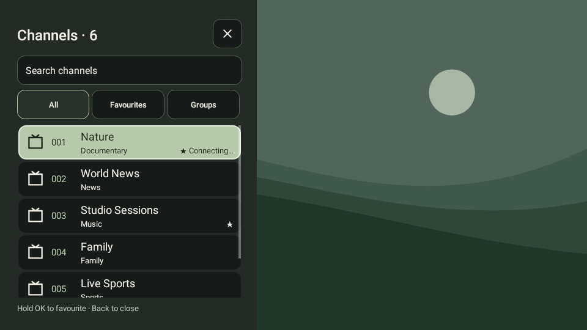
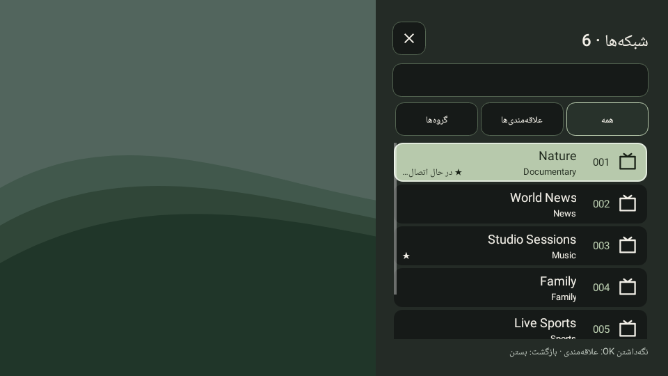
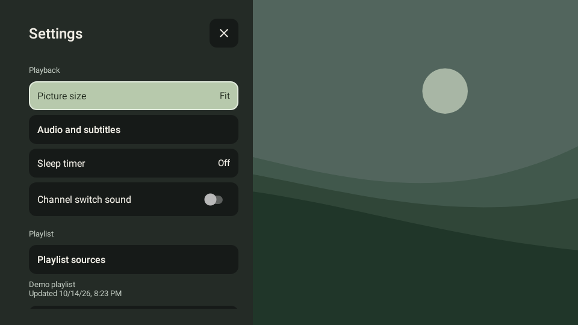
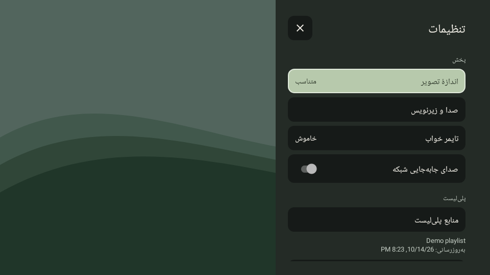
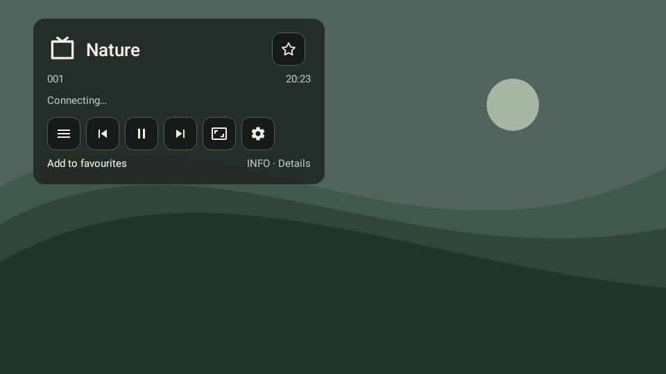
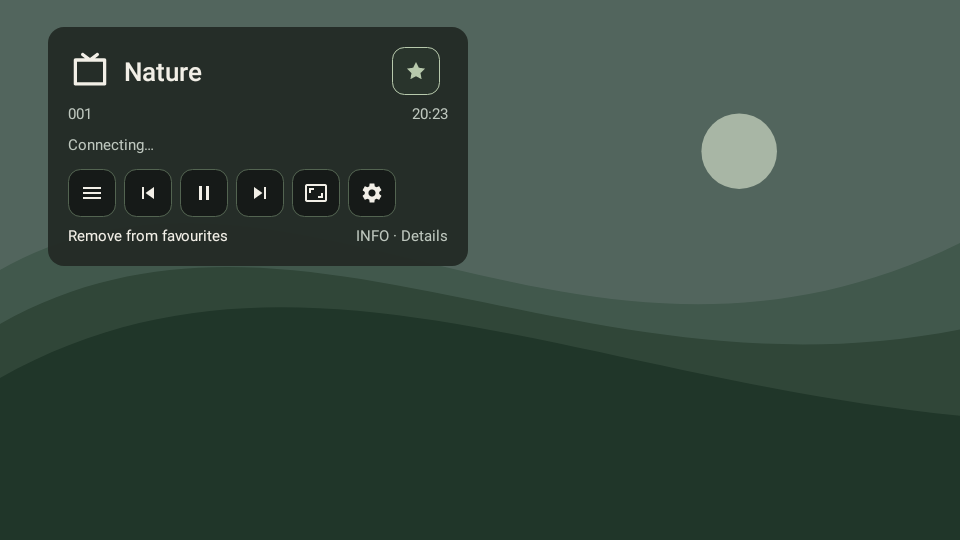

# Phase 7: bilingual panels and visible favourite state

Candidate: CouchZap **2.1.3 (12)**. This build is for phone/TV user testing before a new stable release.

## Changes

- Persian channel and settings panels dock on the right; English panels keep the left edge. TV safe padding follows the outside edge. Portrait phone panels still use the full screen width. Live language switching and configuration changes retain the correct side, focus and mode value.
- Language uses the same 16sp text size and existing button typeface as adjacent settings buttons, in Persian and English.
- Interface mode shows only the localized selected value: Automatic, TV or Touch. No repeated Interface prefix; the value survives language and orientation changes.
- Settings root and child pages hide their scrollbars on phones and TV. Scrolling and remote navigation remain active. The channel list retains its vertical scrollbar on both device types, following the user's final preference.
- The Info favourite control uses an outlined star when absent and a filled sage star when present. The shapes remain distinct under remote focus, where both use the high-contrast focus tint. The action label and localized accessibility checked state stay synchronized when toggled, reopened or changed to another channel.

The API 26+ default focus-highlight fix from 2.1.2 is retained.

## Validation

- 106 unit/Robolectric cases, with zero failures, errors or skips. Behavioral coverage includes API 24 and 36; native rendering includes API 28 and 36.
- New checks cover both panels at startup/live language switching, phone/TV layout, configuration changes, all mode values, matching language typography, retained touch scrolling, channel scrollbars and touch/remote favourite persistence.
- Native favourite checks inspect actual center pixels in filled/outline states, both focused and unfocused, on phone and TV in both languages. Screenshot fixtures initialize favourites deterministically between renders.
- Debug/release lint passed with zero errors (124 debug and 123 release warnings remain). Optimized signed release assembly passed. Signing uses the existing private release key outside the repository.

## Native screenshots

These render real Android views with Robolectric native graphics. Channel/programme data and the backdrop are fixtures; they are not physical-device captures or live streams.

| View | English | Persian |
| --- | --- | --- |
| TV channels, API 28 |  |  |
| TV settings, API 28 |  |  |
| Phone settings after Back, API 36 |  |  |

| Favourite state | Off | On |
| --- | --- | --- |
| English TV, API 28 |  |  |
| Persian phone, API 36 |  |  |

Physical-device verification of these changes remains the next user check. This candidate does not alter streaming/TLS or the signing certificate. Stable release publishing notes and the reviewed-APK reconstruction recipe are updated only when preparing that release.
