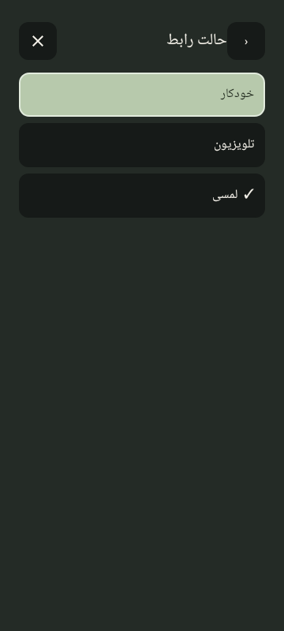
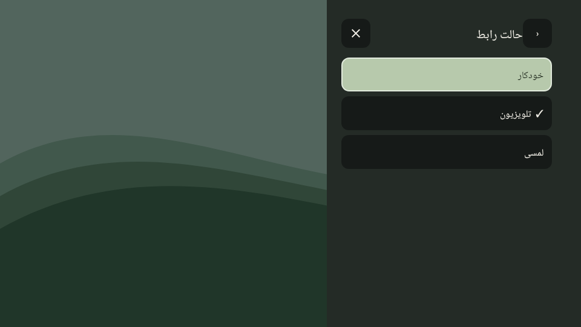
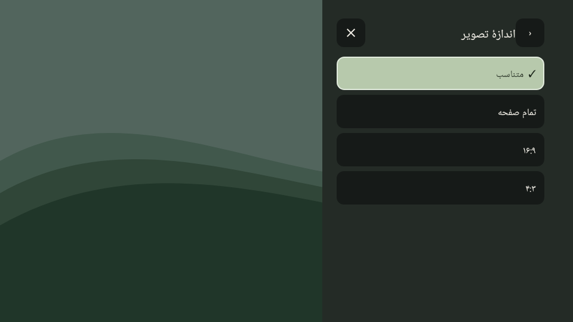

# Phase 8: Persian localization and uninterrupted channel search

Candidate: CouchZap **2.1.4 (13)**, retaining the user-verified 2.1.3 interface fixes.

## Changes

- Persian mode choices and the current settings value display **تلویزیون** for TV. The stored interface preference remains `TV`.
- Aspect choices and the selected value use **۱۶:۹** and **۴:۳** in Persian. English labels and the stored numerical aspect modes are preserved.
- Known IPTV categories are localized in both the Groups picker and channel rows. This includes all 30 categories in the official catalog checked on 2026-10-15, plus Undefined/Other. Auto means خودرو in this catalog. English labels and unknown custom group names remain intact. Filtering uses the original playlist groups, preserving cached channel identity and favourites.
- Entering search cancels delayed row-navigation requests. Refreshing results and resuming the activity do not restore a channel row while the editor owns focus. Unspecified IME events no longer submit the query; explicit Search/Done/Go or Enter can enter matching results. Empty results keep the editor available for correction.
- Search text, caret and composing spans survive live filtering, including multiword English/Persian input, spaces and clearing the query on phone and TV.

## Validation

- The search regression was first run against 2.1.3: all four API 24/API 36 cases failed on implicit IME submission or a delayed offscreen navigation request. The same cases pass after the fix.
- **116 unit/Robolectric cases passed**, with zero failures, errors or skips. The complete debug/release lint and optimized signed release assembly passed.
- Localization tests use the real group dialog, filter results and cached playlists; mode/aspect tests cover live language switching and saved values.
- Native rendering on API 28 and 36 checks that the first ratio digit appears to the left of the last digit, and that search retains focus across repeated composing-text updates. Images contain fixture channel data and are not physical-device captures.
- All 2.1.3 regression coverage, including right-side Persian panels, scrollbar policy, favourite state and the Android 16 focus-halo fix, remains enabled.

The APK is signed privately with the existing release key. Physical phone/TV verification of this candidate is the next device check.

## Native screenshots

| View | Android 16 phone | Android TV layout, API 28 |
| --- | --- | --- |
| Interface choices |  |  |
| Persian aspect digits |  |  |
| Multiword search and group label |  |  |
